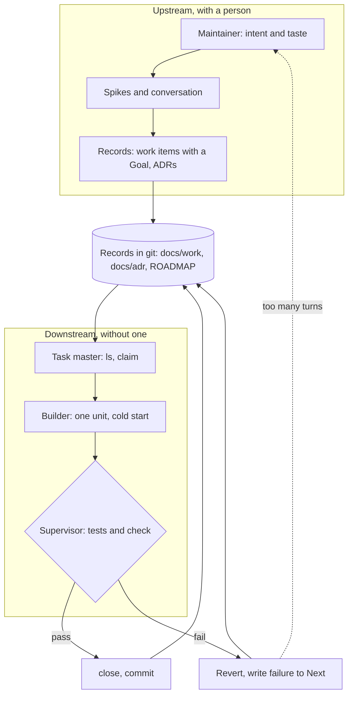

# Consultation: AKM as the memory of an unattended agent loop

A brainstorm, condensed. The maintainer walked with a hosted model (Gemini) and gave it three inputs: Anthropic's paper on the trouble with long-running agent sessions, Matt Pocock's AI Hero pages on building an unattended ("AFK") software factory around the Ralph loop, and this tool. The model's output was uneven; this note keeps what survived a check against the specification and the open work. None of the cited material was re-read for this note, so claims about it are as the maintainer reported them. This note decides nothing. Work that follows is under [261031-v07x](../work/261031-v07x-ralph-loop-consultation.md); ideas that are not AKM's job are in [ideas](../ideas/README.md).

## The setting

A Ralph loop runs a fresh agent in a fixed cycle until the work runs out: take the next task, do one unit, check it, record it, exit, repeat. Each turn starts cold, so everything the next turn needs must be on disk. That is the problem AKM already solves for people who resume work: `## Goal`, `## Next`, `## Log`, claims, and decisions in ADRs.

## The model that came out

Two zones.

- **Upstream, with a person.** Taste and direction go in through spikes and conversation. The output is records: work items with a Goal that can be checked, and ADRs for the choices.
- **Downstream, without one.** Three roles repeat: a **task master** picks and claims the next ready leaf (`ls`, `claim`), a **builder** does one unit with only `AGENTS.md` and the item in view and leaves `## Next` and `## Log` fit for the next turn, and a **supervisor** runs tests and `akmctl check`, and either closes the item or puts the failure in `## Next` and reverts.

The records are the shared state; `akmctl` is the only door to them. The loop script is outside this repository's scope (see [ralph-harness](../ideas/ralph-harness.md)).

An electrical analogy was tried (a feedback circuit with a comparator, a breaker, a bus). It helped the maintainer think and does not belong in the standard; see [circuit-model](../ideas/circuit-model.md).

## What AKM gives over an ad-hoc agent setup

| Pillar                          | A plain chat agent                                          | AKM with a loop                                                      |
| ------------------------------- | ----------------------------------------------------------- | -------------------------------------------------------------------- |
| Memory and state                | Context window and chat history; lost on compaction or exit | Records in git; a turn can die and the next resumes                  |
| Task granularity and transition | One large instruction; fuzzy "done"                         | Statuses with rules (a claim, a non-empty Outcome, closable parents) |
| Decision lineage                | Reasoning in lost chat logs                                 | ADRs and `decisions` links, read before changing a choice            |
| Who does what                   | A person supervises every step or waits for a long run      | A person decides upstream; agents do bounded units                   |
| Verification                    | The model reports its own success                           | Tests and `check` run outside the model                              |

The fifth row is the weakest today, which is gap 1 below. Reworking this table into prose for the guide is [261031-fqbg](../work/261031-fqbg-akm-guide-value-proposition.md).

## Gaps found, and what happened to each

1. **Done is not checked against the Goal.** WK7 requires `## Goal` and a non-empty `## Outcome` but `close` never reads the checkboxes. A one-line Outcome closes an item. Fix: `close done` refuses while a Goal line is unchecked, plus a way to tick a line with evidence. Filed: [261031-zek2](../work/done/261031-zek2-close-checks-goal-checkboxes.md). The model suggested a full `checklist` command family; `section` already writes sections, so the new part is only the per-line tick.
2. **Flapping.** A cold agent can rewrite `## Next` with a new guess every turn and never converge, while every exit code is 0. The model proposed an `iterations` counter in frontmatter; that would dirty a tracked file each turn. Claim and release steps already leave `AKM-Step` and `AKM-Item` trailers in git. Spike: [261031-st7s](../work/261031-st7s-claim-churn-loop-detection.md).
3. **Decisions made in a task and forgotten.** The model proposed a `promote-decision` command that mints an ADR from a task's text. `decisions` links and `proposed` ADRs already cover the need; a codemod is convenience. Kept as an idea: [decision-promotion](../ideas/decision-promotion.md).
4. **Files outside the task.** An unattended agent can touch anything. ADRs have `scope`; work items do not. Spike: [261031-xmn6](../work/261031-xmn6-work-item-scope-field.md).
5. **Work too big for one context.** Large items must be split before the loop takes them, and the loop must take only leaves. Mostly covered already: `split` and `new --parent` in [261031-ph53](../work/261031-ph53-new-parent-kind-flags-and-split-command.md), `ls --descendants` in [261031-qwhn](../work/261031-qwhn-ls-descendants-and-tree-view.md), leaf routing in [261031-w3ms](../work/261031-w3ms-spike-ready-leaf-routing-in-nested-projects.md). The new requirement for that spike is that the answer to "what next" is always a leaf. An agent that decomposes by itself (`decompose`) waits until `split` exists.

## Left as documentation

- A reference loop built only from `ls`, `claim`, `section`, `check` and `close`: [261031-02ff](../work/261031-02ff-ralph-loop-reference-doc.md).

## Not verified

- The cited paper and pages were not re-read; the model's descriptions of them may be off.
- Nothing here was run. The command shapes in the gaps are proposals.
