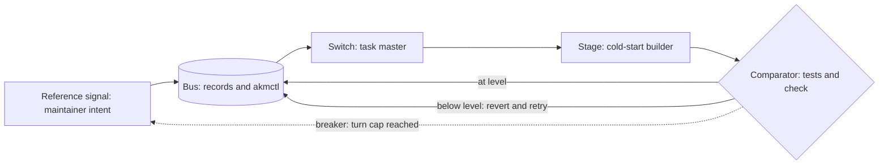

# The circuit model

Status: `idea`. A way of thinking, not a feature.

## The idea

Read an unattended loop as a feedback circuit.

| Part of the loop                       | In the circuit                                          |
| -------------------------------------- | ------------------------------------------------------- |
| The maintainer's intent and taste      | The reference signal                                    |
| The records and `akmctl`               | The bus and its registers; the tool is the bus protocol |
| The task master                        | A switch that takes one task from the pool              |
| The cold-start builder                 | A stage that starts empty, does one unit and is gone    |
| The supervisor (tests and `check`)     | A comparator against the acceptance level               |
| Revert and retry                       | Negative feedback                                       |
| A cap on turns per item, then a person | A breaker                                               |

It is useful because it says what each part must not do: the builder must not judge its own output (the comparator's job), and the bus must not depend on who wrote to it. It also names what is missing from a loop that has no breaker.

## Why it is only an idea

It adds no rule or command. Two loops built on AKM can agree on the records and disagree on the metaphor. Diagrams in this style are worth keeping for talks and for the AI-architecture reading group, not in the standard.

## First step

If it earns a place, a single diagram in the loop reference page ([261031-02ff](../work/261031-02ff-ralph-loop-reference-doc.md)), drawn in plain Mermaid with every label quoted.
