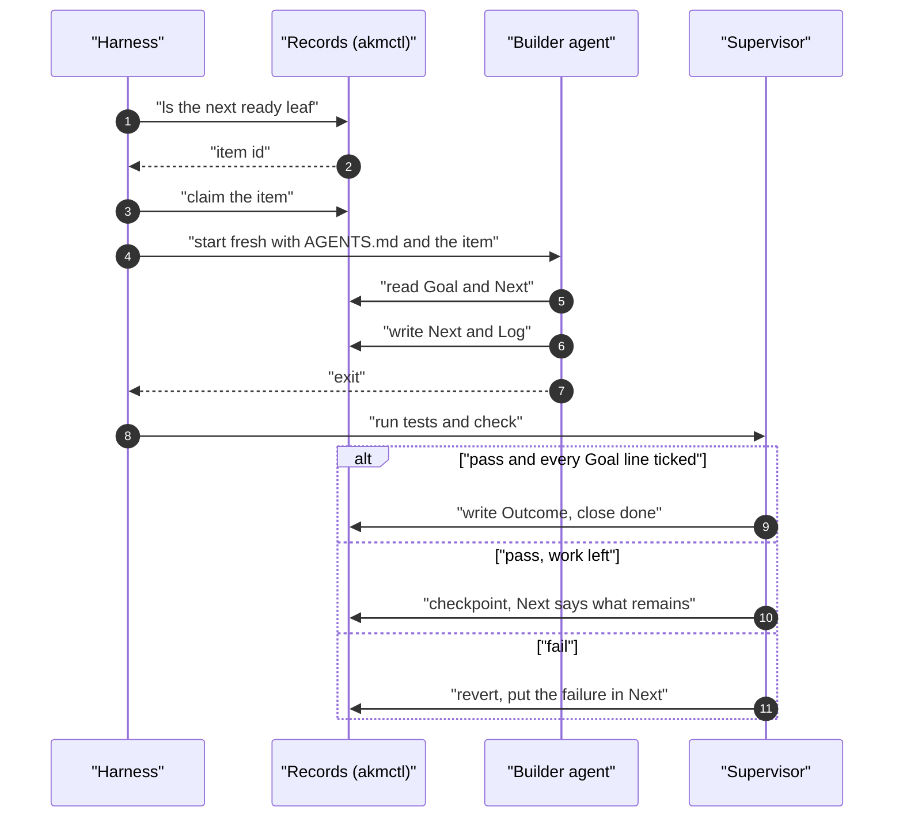

# Unattended loop harness

Status: `filed`. The tool-side pieces are under [261031-v07x](../work/261031-v07x-ralph-loop-consultation.md); the reference page is [261031-02ff](../work/261031-02ff-ralph-loop-reference-doc.md). The harness itself stays outside this repository.

## The idea

A short script runs a fresh agent over and over. Each turn it takes one ready leaf item, lets the agent do one unit, checks the result outside the model, and records it. A person works upstream (spikes, specs, ADRs) and reads the results later.

```text
loop:
  next = akmctl ls --status active,ready --format json   # resume an active item, else the top ready leaf
  akmctl claim <id> --as builder
  run a fresh agent with AGENTS.md and the item
  run tests, then akmctl check
  pass and every Goal line ticked:  write Outcome, akmctl close <id> done, commit
  pass, work left:                  commit a checkpoint; Next says what remains
  fail:                             revert the working tree; put the failure in Next
  stop when nothing is left, a budget is spent, or an item stays active too long
```

One turn, as a sequence:



## What AKM already gives it

- State that survives a dead process: `## Goal`, `## Next`, `## Log`, claims.
- One door to the records: `ls`, `claim`, `section`, `close`, `check`, all with JSON and exit codes.
- A check that does not depend on the model's word: `akmctl check` and the project's tests.

## What it would still need

- `close` that reads the Goal checkboxes ([261031-zek2](../work/done/261031-zek2-close-checks-goal-checkboxes.md)).
- A way to see an item that keeps flapping ([261031-st7s](../work/261031-st7s-claim-churn-loop-detection.md)).
- A way to keep an agent inside its task ([261031-xmn6](../work/261031-xmn6-work-item-scope-field.md)).
- Leaf-only routing, so no turn is handed a project too big for one context ([261031-w3ms](../work/261031-w3ms-spike-ready-leaf-routing-in-nested-projects.md)).
- A sandbox for the agent. That is the harness's job; AKM cannot give one.

## First step

The reference page, run once against a scratch repository.
